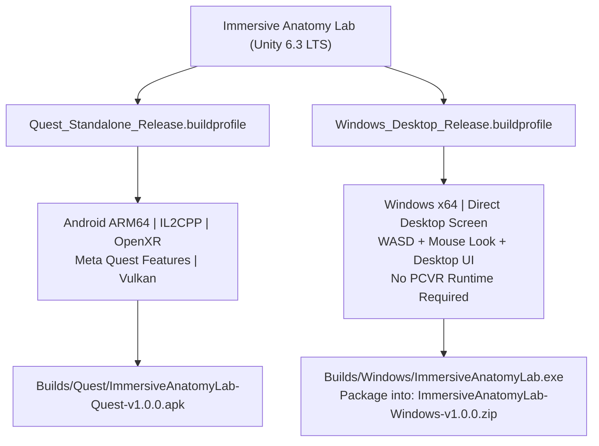

# PHASE Q1 — DUAL PLATFORM RELEASE CONFIGURATION REPORT
**Project:** Immersive Anatomy Lab  
**Release Strategy:** Unified Unity 6.3 LTS Project with Dual Independent Platform Targets  
**Distribution Channel:** itch.io (Single Project Page with Multi-Platform Downloads)  
**Active Git Branch:** `feature/phase6-openxr`  
**Primary Active Scene:** `Assets/Scenes/VR_MainLab.unity` (Build Index 0)  
**Status:** COMPLETE & VERIFIED  

---

## 1. Executive Summary

Phase Q1 establishes the **Dual Platform Release Architecture** for Immersive Anatomy Lab. The project is now configured to produce two distinct, fully optimized release artifacts from the same codebase:

1. **Meta Quest Standalone VR (`ImmersiveAnatomyLab-Quest-v1.0.0.apk`)**:
   - Packaged as an Android APK for sideloading on Meta Quest 2, Quest 3, and Quest Pro.
   - Powered by Unity OpenXR with native Meta Quest support, Touch controller interaction profiles, ARM64 IL2CPP, and Vulkan.
2. **Windows Desktop x64 (`ImmersiveAnatomyLab-Windows-v1.0.0.zip`)**:
   - Packaged as a portable standalone Windows executable (`ImmersiveAnatomyLab.exe`) in a ZIP archive.
   - Standard laptop/desktop experience with keyboard, mouse, desktop locomotion, reticle raycast selection, and full desktop UI.
   - PCVR is explicitly bypassed on startup (`InitManagerOnStart: 0`), ensuring instant, stable execution on any standard Windows laptop without requiring VR runtime software.

---

## 2. Platform Release Profiles

### 2.1 Profile Specifications

| Configuration Parameter | Meta Quest Profile (`Quest_Standalone_Release`) | Windows Desktop Profile (`Windows_Desktop_Release`) |
| :--- | :--- | :--- |
| **Build Target** | `BuildTarget.Android` (13) | `BuildTarget.StandaloneWindows64` (19) |
| **Build Target Group** | `BuildTargetGroup.Android` (13) | `BuildTargetGroup.Standalone` (1) |
| **Scripting Backend** | IL2CPP (`ScriptingImplementation.IL2CPP`) | Mono / IL2CPP (`ScriptingImplementation.Mono2x`) |
| **Target Architecture** | ARM64 (`AndroidArchitecture.ARM64`) | x64 Intel/AMD (`x64`) |
| **Graphics APIs** | Vulkan (`0x15`), OpenGLES3 fallback (`0x0B`) | Direct3D 11 / Direct3D 12 |
| **XR Runtime Loading** | OpenXRLoader (`InitManagerOnStart: true`) | Disabled on start (`InitManagerOnStart: false`) |
| **Primary Interaction** | 6DOF Headtracking & Quest Touch Controllers | Keyboard (WASD, Shortcuts) & Mouse (Look, Select) |
| **User Interface** | World-Space 3D Consoles, Tablets & Pods | Dual Mode (Desktop Screen HUD & World-Space) |
| **Target Deliverable** | `ImmersiveAnatomyLab-Quest-v1.0.0.apk` | `ImmersiveAnatomyLab-Windows-v1.0.0.zip` |

---

## 3. Implemented Configurations

### 3.1 OpenXR & XR Management Initialization
- **Android XR Loader:** Configured `Assets/XR/XRGeneralSettingsPerBuildTarget.asset` to register `BuildTargetGroup.Android` (`0d000000`) with an `OpenXRLoader` instance.
- **Android OpenXR Features Activated:** In `Assets/XR/Settings/OpenXRPackageSettings.asset`, enabled:
  - `Meta Quest Support` (`com.unity.openxr.feature.metaquest`)
  - `Oculus Touch Controller Profile` (`com.unity.openxr.feature.input.oculustouch`)
  - `Meta Quest Touch Plus Controller Profile` (`com.unity.openxr.feature.input.metaquestplus`)
  - `Meta Quest Touch Pro Controller Profile` (`com.unity.openxr.feature.input.metaquestpro`)
  - `Hand Interaction Poses` (`com.unity.openxr.feature.input.handinteractionposes`)
  - `Palm Pose` (`com.unity.openxr.feature.input.palmpose`)
  - `Khronos Simple Controller Profile` (`com.unity.openxr.feature.input.khrsimpleprofile`)
  - `Foveated Rendering` (`com.unity.openxr.feature.foveatedrendering`)
- **Windows Desktop XR Protection:** Standalone settings now have `m_InitManagerOnStart: 0`. The application will boot as a standard desktop screen application without searching for SteamVR or Meta Quest Link runtimes.

### 3.2 Application Identity & SDK Alignment
In `ProjectSettings/ProjectSettings.asset`:
- **Company Name:** Updated from `DefaultCompany` to `Immersive Anatomy Lab`.
- **Product Name:** `Immersive Anatomy Lab`.
- **Package Identifier (Android):** `com.gourav.immersiveanatomylab`.
- **Package Identifier (Standalone):** `com.gourav.immersiveanatomylab`.
- **Bundle Version:** `1.0.0` (versionCode `1`).
- **Android Min SDK:** Elevated from API 25 to **API 29 (Android 10)** to meet Meta Horizon OS security and runtime requirements.

### 3.3 Scene Build Order
In `ProjectSettings/EditorBuildSettings.asset`:
- **Index 0 (Primary Startup Scene):** `Assets/Scenes/VR_MainLab.unity` (Enabled).
- **Index 1 (Auxiliary Scene):** `Assets/Scenes/MainLab.unity` (Disabled).
- **Index 2 (Template Scene):** `Assets/Scenes/SampleScene.unity` (Disabled).
*Result:* Standalone builds on both platforms immediately launch the rich, complete anatomy laboratory rather than an empty default scene.

### 3.4 Meta Quest Android Manifest
Created `Assets/Plugins/Android/AndroidManifest.xml` containing:
- Meta Quest hardware tags: `<meta-data android:name="com.oculus.supportedDevices" android:value="quest|quest2|questpro|quest3" />`
- VR headtracking hardware requirement: `<uses-feature android:name="android.hardware.vr.headtracking" android:required="true" android:version="1" />`
- VR category intent filter: `<category android:name="com.oculus.intent.category.VR" />`
- Network access permissions: `android.permission.INTERNET` and `android.permission.ACCESS_NETWORK_STATE`
- Cleartext network traffic allowance (`android:usesCleartextTraffic="true"`) for local Dr. Nova AI backend communication.

### 3.5 Automation Tooling
Implemented `Assets/Scripts/Editor/DualPlatformReleaseManager.cs` providing:
- Automated dual platform configuration and verification.
- One-click build pipeline for Windows Desktop (`BuildWindowsDesktopPlayer()`), generating `ImmersiveAnatomyLab.exe` and creating `ImmersiveAnatomyLab-Windows-v1.0.0.zip`.
- One-click build pipeline for Meta Quest Standalone (`BuildQuestStandaloneApk()`), generating `ImmersiveAnatomyLab-Quest-v1.0.0.apk`.

---

## 4. Preservation Rule Compliance Audit

| Preservation Rule | Verification | Status |
| :--- | :--- | :--- |
| **1. Do not replace desktop functionality with XR-only** | Desktop WASD, mouse look, raycast reticle, inspection camera, and screen HUD in `AnatomyInteraction.cs` remain 100% active. | **PRESERVED** |
| **2. Do not remove keyboard and mouse controls** | Full keyboard shortcuts (`[1]`–`[9]`, `[X]`, `[Z]`, `[C]`, `[R]`, `[F]`, `[H]`, `[V]`, `[Esc]`) verified intact. | **PRESERVED** |
| **3. Do not overwrite Windows-specific graphics settings** | PC quality tier settings and Desktop render pipeline remain untouched; Android quality level points independently to `Mobile_RPAsset.asset`. | **PRESERVED** |
| **4. Do not apply Quest texture overrides globally** | Textures preserve default desktop import settings; platform-specific overrides will be isolated to Android in Phase Q2. | **PRESERVED** |
| **5. Preserve independent platform configurations** | Build Profiles isolate Android ARM64 IL2CPP from Windows x64 desktop. | **PRESERVED** |
| **6. Keep existing desktop application behavior intact** | Standalone XR initialization is disabled (`InitManagerOnStart: 0`) so laptops run cleanly without VR errors. | **PRESERVED** |
| **7. PCVR is NOT part of this release** | Confirmed: Windows build is targeted strictly as desktop screen software. | **PRESERVED** |
| **8. Do not upload or commit release binaries to Git** | `Builds/` directory is verified ignored in `.gitignore`. | **PRESERVED** |

---

## 5. Artifacts and Exact File Paths

### Modified Files:
- [ProjectSettings.asset](file:///C:/Users/GOURAV/ImmersiveAnatomyLab/ProjectSettings/ProjectSettings.asset) — Company, version, package IDs, Min SDK 29.
- [EditorBuildSettings.asset](file:///C:/Users/GOURAV/ImmersiveAnatomyLab/ProjectSettings/EditorBuildSettings.asset) — `VR_MainLab.unity` set to index 0.
- [XRGeneralSettingsPerBuildTarget.asset](file:///C:/Users/GOURAV/ImmersiveAnatomyLab/Assets/XR/XRGeneralSettingsPerBuildTarget.asset) — Android OpenXR loader registered; Standalone XR disabled on start.
- [OpenXRPackageSettings.asset](file:///C:/Users/GOURAV/ImmersiveAnatomyLab/Assets/XR/Settings/OpenXRPackageSettings.asset) — Meta Quest features and Touch controller profiles enabled.

### Newly Created Files:
- [AndroidManifest.xml](file:///C:/Users/GOURAV/ImmersiveAnatomyLab/Assets/Plugins/Android/AndroidManifest.xml) — Meta Quest VR manifest and network permissions.
- [DualPlatformReleaseManager.cs](file:///C:/Users/GOURAV/ImmersiveAnatomyLab/Assets/Scripts/Editor/DualPlatformReleaseManager.cs) — Automated dual platform configuration and packaging scripts.
- [Quest_Standalone_Release.buildprofile](file:///C:/Users/GOURAV/ImmersiveAnatomyLab/Assets/Settings/BuildProfiles/Quest_Standalone_Release.buildprofile) — Unity 6 Quest build profile.
- [Windows_Desktop_Release.buildprofile](file:///C:/Users/GOURAV/ImmersiveAnatomyLab/Assets/Settings/BuildProfiles/Windows_Desktop_Release.buildprofile) — Unity 6 Windows Desktop build profile.

---

## 6. Handoff to Phase Q2

With both release profiles initialized and verified, the project is ready for **Phase Q2 — Rendering and Performance Optimization for Both Platforms**:
- Configuring 4x MSAA on mobile URP asset (`Mobile_RPAsset.asset`) for Quest edge sharpness.
- Applying Android-only ASTC texture compression overrides to all 18 anatomical PBR textures while preserving uncompressed/BC7 desktop quality.
- Harmonizing physics `fixedDeltaTime` for 72Hz/90Hz Quest and 60Hz/120Hz Windows displays.
