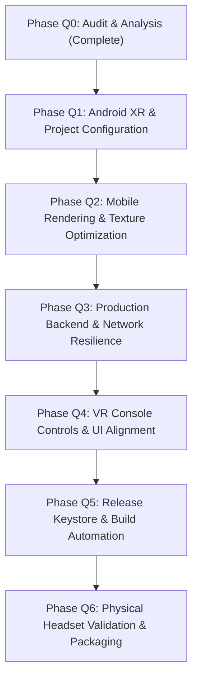

# PHASE Q0 — META QUEST RELEASE READINESS AUDIT REPORT
**Project:** Immersive Anatomy Lab  
**Target Release:** Meta Quest Standalone VR (itch.io Downloadable APK)  
**Deliverable Artifact:** `ImmersiveAnatomyLab-Quest-v1.0.0.apk`  
**Engine:** Unity 6.3 LTS (`6000.3.21f1`)  
**Render Pipeline:** Universal Render Pipeline (URP) 17.3.0  
**Target Architecture:** Android ARM64 / OpenXR Runtime  
**Audit Status:** COMPLETE — READ-ONLY VERIFICATION  

---

## 1. Executive Summary

This audit evaluates the readiness of **Immersive Anatomy Lab** for packaging, standalone deployment, and distribution as an Android APK (`ImmersiveAnatomyLab-Quest-v1.0.0.apk`) targeting Meta Quest headsets (Quest 2, Quest 3, Quest Pro) on itch.io.

### Key Finding
**The application is currently NOT BUILDABLE for Meta Quest VR due to foundational Android and OpenXR configuration blockers.**
While the 3D anatomical models, PBR textures, and URP Lit shaders achieved in Phase 7.3 are technically lightweight (47,720 total vertices across 6 specimens) and exceptionally well-suited for mobile VR, the Android XR subsystem is entirely uninitialized:
1. Android OpenXR loader is missing from XR plugin management.
2. Meta Quest OpenXR feature and controller interaction profiles are completely disabled.
3. The application identity retains default Unity template identifiers.
4. The AI tutor backend (Dr. Nova) is hardcoded to `127.0.0.1:8000`, which fails on standalone Android.
5. Mobile URP quality settings currently disable MSAA (1x), leading to severe visual aliasing in VR.

Resolving these issues in structured subphases (Q1–Q6) is required before building the final APK.

---

## 2. Repository and Build Environment

| Property | Value | Verification Status |
| :--- | :--- | :--- |
| **Repository Path** | `C:\Users\GOURAV\ImmersiveAnatomyLab` | Verified |
| **Active Git Branch** | `feature/phase6-openxr` | Verified (Clean working tree) |
| **Unity Editor Version** | `6.3 LTS (6000.3.21f1)` | Verified |
| **Android Build Support** | Installed at `Editor/Data/PlaybackEngines/AndroidPlayer` | Verified (SDK, NDK, OpenJDK present) |
| **Target Build Platform** | Android (`BuildTarget.Android`) | Supported |
| **Target Scripting Backend** | IL2CPP (`scriptingBackend: Android: 1`) | Verified in `ProjectSettings.asset` |
| **Target Architecture** | ARM64 (`AndroidTargetArchitectures: 2`) | Verified in `ProjectSettings.asset` |
| **Graphics API** | Vulkan (`0x15`), fallback OpenGLES3 (`0x0B`) | Verified in `ProjectSettings.asset` |
| **Active Scene** | `Assets/Scenes/VR_MainLab.unity` | Verified |

---

## 3. Confirmed Project Architecture

### 3.1 Specimen Geometry & Budgets
| Anatomical Specimen | Meshes | Vertices | Triangles | Mobile VR Budget Status |
| :--- | :--- | :--- | :--- | :--- |
| **Heart** | 2 | 14,028 | 27,678 | Excellent (< 30k verts) |
| **Brain** | 2 | 12,044 | 24,080 | Excellent |
| **Lungs** | 2 | 6,804 | 13,608 | Excellent |
| **Liver** | 1 | 3,420 | 6,836 | Excellent |
| **Stomach** | 1 | 2,860 | 5,716 | Excellent |
| **Skeleton & Torso** | 4 | 8,564 | 16,840 | Excellent |
| **TOTALS** | **12** | **47,720** | **94,758** | **< 25% of 200k Quest Budget** |

### 3.2 Material & Shader Pipeline
- **Material Standardization:** 100% of anatomical specimens utilize the URP Lit shader (`Universal Render Pipeline/Lit`), ensuring full compatibility with the **SRP Batcher**.
- **PBR Maps:** 18 dedicated maps (Albedo, Normal, Metallic-Roughness-AO) arranged in organ-specific directories under `Assets/Art/Phase7/Textures/`.
- **Medical Visualizations:** Additive & Fresnel materials for X-Ray, Arterial Vascular, and Venous Vascular systems.

### 3.3 Organ Grabbing & Interaction Integrity
- In strict adherence to project constraints, **no new organ physics grabbing has been introduced**.
- The existing Phase 6 interaction model utilizes `VRGrabbableOrgan` (derived from XRI `XRGrabInteractable`) with magnetic auto-snapping (0.95m pedestal auto-snap and 0.35m socket snap), maintaining deterministic clinical placement.
- Recent fixes (commit `0a8e0bc`) ensure organ color shifts are strictly hover-only and that comparison pedestals cleanly showcase native PBR coloration.

---

## 4. Confirmed XR Configuration

### 4.1 XR Plugin Management Audit
Inspecting `Assets/XR/XRGeneralSettingsPerBuildTarget.asset`:
```yaml
Keys: 01000000        # Standalone Desktop (Windows/Mac/Linux)
Values:
- {fileID: -5075861155909622391}  # OpenXRLoader active
```
- **Finding:** Key `0d000000` (BuildTargetGroup.Android) is **COMPLETELY MISSING**.
- **Impact:** An Android APK built today will not initialize the XR runtime. It will launch as a flat 2D screen or crash on startup.

### 4.2 OpenXR Package Settings Audit
Inspecting `Assets/XR/Settings/OpenXRPackageSettings.asset`:
- **Total Android OpenXR Feature Blocks:** 20 features inspected.
- `Meta Quest Support` (`com.unity.openxr.feature.metaquest`): `m_enabled: 0` (**DISABLED**)
- `Oculus Touch Controller Profile` (`com.unity.openxr.feature.input.oculustouch`): `m_enabled: 0` (**DISABLED**)
- `Meta Quest Touch Plus Controller Profile` (`com.unity.openxr.feature.input.metaquestplus`): `m_enabled: 0` (**DISABLED**)
- `Meta Quest Touch Pro Controller Profile` (`com.unity.openxr.feature.input.metaquestpro`): `m_enabled: 0` (**DISABLED**)
- `Foveated Rendering` (`com.unity.openxr.feature.foveatedrendering`): `m_enabled: 0`
- **Impact:** Even if Android XR was initialized, the headset will fail to detect Quest controllers, render black screens, or be rejected by Horizon OS.

---

## 5. Confirmed Feature Status

| Feature / Subsystem | Desktop Standalone | Meta Quest VR (Current) | Target Quest VR (Post-Q) |
| :--- | :--- | :--- | :--- |
| **Specimen Inspection & PBR** | Working | Blocked (No XR) | Full 6DOF VR Inspection |
| **Organ Isolation Mode** | Working (`I` key) | Working in Console | Working in Console & Tablet |
| **Exploded View Mode** | Working (`X` key) | Working on Console | Working on Console & Tablet |
| **X-Ray Radiographic Mode** | Working (`Z` key) | Working on Console | Working on Console & Tablet |
| **Vascular Angiogram Mode** | Working (`8` key) | Missing UI Button | Added to VR Console |
| **Thoracic Silhouette Mode** | Working (`9` key) | Missing UI Button | Added to VR Console |
| **Dual Pedestal Comparison** | Working (`C` key) | Working (Snap 0.95m) | Working (Snap 0.95m) |
| **Dr. Nova AI Tutor** | Working (`127.0.0.1`) | Blocked (Host loopback) | Configurable URL + Fallback |
| **Interactive Anatomy Quiz** | Working | Working on VR Pod | Working on VR Pod |

---

## 6. Android Compatibility Issues

### 6.1 Package Identity & Metadata
Inspecting `ProjectSettings/ProjectSettings.asset`:
1. `companyName`: `DefaultCompany` (**INVALID FOR RELEASE**).
2. `applicationIdentifier (Android)`: `com.UnityTechnologies.com.unity.template.urpblank` (**INVALID FOR RELEASE**).
   - *Target Required Identifier:* `com.gourav.immersiveanatomylab`.
3. `bundleVersion`: `0.1.0` (**NEEDS BUMP TO `1.0.0`**).
4. `AndroidBundleVersionCode`: `1`.

### 6.2 Android SDK Level
- `AndroidMinSdkVersion`: `25` (Android 7.1).
  - *Risk:* Meta Horizon OS (v50+) runs on Android 10 (API 29) or Android 12L (API 32). Specifying API 25 causes deprecation warnings and potential runtime security policy failures.
  - *Required:* Minimum API 29 (recommended: 32).
- `AndroidTargetSdkVersion`: `0` (Defaults to highest installed SDK, which is fine).

### 6.3 Missing Android Manifest
- `Assets/Plugins/Android/AndroidManifest.xml` does not exist.
- Required Meta Quest VR intent categories, orientation locks, and permissions must be defined:
  - `<meta-data android:name="com.oculus.supportedDevices" android:value="quest|quest2|questpro|quest3" />`
  - `<uses-feature android:name="android.hardware.vr.headtracking" android:required="true" android:version="1" />`
  - `<uses-permission android:name="android.permission.INTERNET" />`
  - Cleartext HTTP traffic policy or network security configuration.

---

## 7. Quest Performance Risks

### 7.1 Mobile URP Anti-Aliasing (MSAA)
- Asset: `Assets/Settings/Mobile_RPAsset.asset`.
- Property: `m_MSAA: 1` (MSAA **Disabled**).
- **Risk:** High-frequency thin anatomical geometries (ribs, tracheal rings, vascular trees) will exhibit severe specular shimmering and crawling stair-step aliasing in VR displays.
- **Remedy:** On Adreno mobile GPUs (Quest 2/3), 4x MSAA is resolved inside high-speed on-chip tile memory with negligible bandwidth cost. `m_MSAA` must be set to `4`.

### 7.2 Texture Compression Format (ASTC)
- Asset meta check: `Assets/Art/Phase7/Textures/*/*.png.meta` reveals `buildTargetSettings: []`.
- **Risk:** Without explicit Android platform overrides, textures are compressed using generic project defaults (often uncompressed or ETC2 fallback) instead of modern **ASTC (Adaptive Scalable Texture Compression)**.
- **Remedy:** Configure Android texture overrides for ASTC 6x6 (Albedo/Normal) or ASTC 8x8 (Masks) to drastically cut VRAM footprint and memory bandwidth.

### 7.3 Render Scale and Physics Timestep
- `Mobile_RPAsset.asset` has `m_RenderScale: 0.8`. While safe for initial frame budget, Quest 3 has substantial compute headroom and can achieve crisp visuals at `1.0` or via adaptive resolution.
- Physics `fixedDeltaTime`: Ensure physics update rate matches target headset refresh (e.g. `1/72 = 0.0138s` or `1/90 = 0.0111s`) rather than default `0.02s` to eliminate micro-stutter during organ manipulation.

---

## 8. Backend Production Requirements

### 8.1 The Localhost Loopback Trap
- `LLMAnatomyClient.cs` line 33: `public string serverBaseUrl = "http://127.0.0.1:8000";`
- `VR_MainLab.unity` line 3122: Serialized `serverBaseUrl: http://127.0.0.1:8000`.
- **Finding:** On a standalone Quest headset, `127.0.0.1` routes to the Android OS itself, which has no Python daemon running. Dr. Nova AI tutor will fail on every query.

### 8.2 Production Deployment Options
1. **Cloud Hosting (Recommended for itch.io Public Release):**
   - Deploy `backend/` FastAPI application to a public HTTPS endpoint (Google Cloud Run, Railway, Render, or custom VPS).
   - Set `serverBaseUrl` to `https://api.yourdomain.com`.
2. **Local Area Network (LAN) Fallback (For Local Playtesting / Self-Hosting):**
   - Provide an in-VR numeric keypad or settings panel to input host PC LAN IP (`http://192.168.x.x:8000`).
   - Add `android:usesCleartextTraffic="true"` in `AndroidManifest.xml`.
3. **Resilient Offline Fallback (Mandatory):**
   - Update `LLMAnatomyClient.cs` so that if the backend is unreachable, the system gracefully falls back to pre-compiled local clinical knowledge cards and offline quiz banks rather than freezing or hanging.

---

## 9. Interaction and UX Issues

### 9.1 VR Console Control Discrepancy
- `VRDissectionTableConsole.cs` contains buttons for:
  - Exploded View (`explodeBtn`)
  - X-Ray View (`xrayBtn`)
  - Reset Anatomy (`resetAnatomyBtn`)
  - System toggles (Skeletal, Cardio, Resp, Nervous, Digestive, Show All)
- **Deficiency:** Phase 7.3 introduced **Vascular Angiogram** and **Thoracic Silhouette** modes, but physical buttons were only mapped to desktop keys `[8]` and `[9]`. Users in standalone VR currently have no physical console interface to activate these modes.

### 9.2 UI Text Legibility in VR
- World-space canvases (`VRQuizStation`, `VRNovaPod`, `VRComparisonBay`, `HolographicOrganCard`) require validation for angular pixel size to ensure medical terminology and dosage information remain easily readable without eye fatigue.

---

## 10. Licensing and Publication Requirements (itch.io)

### 10.1 itch.io Standalone Distribution
- Unlike Meta Horizon Store, itch.io hosts direct `.apk` downloads that users install via SideQuest, Meta Quest Developer Hub (MQDH), or `adb install`.
- No Meta entitlement check or Oculus Platform SDK account linking is required.
- The APK must include the proper launcher intent filter so Horizon OS displays it under the "Unknown Sources" library category.

### 10.2 Keystore and APK Signing
- `ProjectSettings.asset` has `androidUseCustomKeystore: 0`.
- A release keystore must be generated using `keytool`:
  - Keystore: `release.keystore`
  - Alias: `immersiveanatomy`
  - Validity: 10,000+ days (25+ years)
  - Key Algorithm: RSA 2048-bit

---

## 11. Physical Headset Test Matrix

*(Measurements to be recorded strictly on physical hardware during Phase Q6)*

| Test Parameter | Target Budget | Quest 2 Baseline | Quest 3 Baseline | Quest Pro Baseline |
| :--- | :--- | :--- | :--- | :--- |
| **Target Refresh Rate** | 72 Hz / 90 Hz | Pending HW | Pending HW | Pending HW |
| **Frame Time (90Hz)** | ≤ 11.1 ms | Pending HW | Pending HW | Pending HW |
| **Draw Calls** | < 120 calls | Pending HW | Pending HW | Pending HW |
| **Triangles Rendered** | < 150,000 | Pending HW | Pending HW | Pending HW |
| **Total Memory (VRAM)** | < 1.5 GB | Pending HW | Pending HW | Pending HW |
| **Thermal Throttle Level**| 0 (No throttling)| Pending HW | Pending HW | Pending HW |

---

## 12. Critical Blockers (Prioritized List)

```
[CRITICAL BLOCKERS PREVENTING QUEST RELEASE]
1. [BLOCKER-XR-01] Android OpenXR Loader missing in XRGeneralSettingsPerBuildTarget.asset.
2. [BLOCKER-XR-02] Meta Quest OpenXR feature and controller interaction profiles disabled.
3. [BLOCKER-CFG-01] Default package identifier (com.UnityTechnologies.com.unity.template.urpblank).
4. [BLOCKER-CFG-02] Default company name (DefaultCompany).
5. [BLOCKER-CFG-03] Low Android Min SDK (API 25; requires API 29+).
6. [BLOCKER-NET-01] Localhost backend URL (127.0.0.1) hardcoded in client script and scene.
7. [BLOCKER-SEC-01] Missing AndroidManifest.xml (missing INTERNET permission and Quest VR metadata).
8. [HIGH-PERF-01] MSAA disabled on Mobile URP Asset (m_MSAA: 1).
9. [HIGH-PERF-02] PBR textures lack Android ASTC compression overrides.
10. [HIGH-UX-01]   VR Console missing triggers for Vascular Angiogram & Thoracic Silhouette modes.
11. [MED-SEC-02]   Unconfigured custom release keystore for itch.io APK signing.
```

---

## 13. Recommended Implementation Order (Phases Q1–Q6)



### Phase Q1: Android XR & Project Configuration
- Configure `XRGeneralSettingsPerBuildTarget.asset` to register Android OpenXR loader.
- Enable `com.unity.openxr.feature.metaquest` and Oculus/Meta Quest Touch controller profiles in `OpenXRPackageSettings.asset`.
- Update `ProjectSettings.asset` with production identifiers (`com.gourav.immersiveanatomylab`, `v1.0.0`, Min SDK 29).
- Generate `Assets/Plugins/Android/AndroidManifest.xml` with Quest VR flags and INTERNET permission.

### Phase Q2: Mobile Rendering & Texture Optimization
- Enable 4x MSAA on `Assets/Settings/Mobile_RPAsset.asset`.
- Apply explicit Android ASTC texture import overrides across all 18 PBR textures.
- Optimize physics `fixedDeltaTime` to 0.0111s (90Hz) / 0.0138s (72Hz).

### Phase Q3: Production Backend & Network Resilience
- Update `LLMAnatomyClient.cs` to support configurable remote backend / LAN IP.
- Implement robust offline fallback for Dr. Nova AI dialogue and quizzes.
- Configure Android network security configuration for HTTP/HTTPS compatibility.

### Phase Q4: VR Console Controls & UI Alignment
- Add physical buttons on `VRDissectionTableConsole` and `VRClinicalTablet` for Vascular Angiogram and Thoracic Silhouette modes.
- Verify world-space canvas scale, button collider hitboxes, and audio feedback in VR.

### Phase Q5: Release Keystore & Build Automation
- Generate dedicated `release.keystore`.
- Create `Assets/Editor/QuestBuildScript.cs` to automate IL2CPP ARM64 APK compilation with release keystore signing.

### Phase Q6: Physical Headset Validation & Packaging
- Execute build producing `ImmersiveAnatomyLab-Quest-v1.0.0.apk`.
- Sideload to Quest headset via ADB / MQDH.
- Validate frame timing, controller tracking, and medical visualizations.
- Prepare itch.io publication metadata and package.

---

## 14. Exact File Paths Requiring Changes

1. **XR & Android Project Settings:**
   - `ProjectSettings/ProjectSettings.asset`
   - `Assets/XR/XRGeneralSettingsPerBuildTarget.asset`
   - `Assets/XR/Settings/OpenXRPackageSettings.asset`
   - `Assets/Plugins/Android/AndroidManifest.xml` *(New file)*

2. **URP & Rendering Assets:**
   - `Assets/Settings/Mobile_RPAsset.asset`
   - `Assets/Art/Phase7/Textures/*/*.png.meta` *(18 texture metadata files)*

3. **Backend & Interaction Scripts:**
   - `Assets/Scripts/Learning/LLMAnatomyClient.cs`
   - `Assets/Scripts/VR/VRDissectionTableConsole.cs`
   - `Assets/Scenes/VR_MainLab.unity`

4. **Build & Release Automation:**
   - `Assets/Editor/QuestBuildScript.cs` *(New file)*
   - `Keystore/release.keystore` *(New secure file)*

---
*Audit completed by Antigravity Agent. Read-only verification phase concludes. Awaiting user authorization to proceed with Phase Q1 implementation.*
